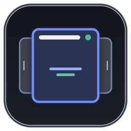

<div align="center">
  
  <h1>AspectShift</h1>
  <p>
    Utilidad nativa, minimalista y portable para cambiar entre resoluciones y relaciones de aspecto en Windows (4:3, 5:4, 16:10 y 16:9).
  </p>
  <p>
    <a href="https://github.com/Alesimm/AspectShift/releases/latest">Descargar ejecutable (.exe)</a> •
    <a href="#sobre-este-proyecto">Sobre el proyecto</a> •
    <a href="#características">Características</a> •
    <a href="#atajos-de-teclado">Atajos</a> •
    <a href="#compilar-desde-el-código-fuente">Compilar</a>
  </p>
</div>

---

## Sobre este proyecto

**AspectShift** es un proyecto personal de código abierto que desarrollé para seguir aprendiendo sobre programación de escritorio nativa en **Rust** e interacción directa con la API de Windows (`Win32`), apoyándome en herramientas de **inteligencia artificial** como asistencia durante el desarrollo y refinamiento de la arquitectura.

La idea nació de querer contar con una herramienta ligera, rápida y portable para alternar entre la resolución panorámica nativa de un monitor y resoluciones con otra relación de aspecto (`4:3`, `5:4`, `16:10`), manteniendo el código limpio y compartible en mi portafolio de GitHub.

---

## Características

- **Cambio directo por monitor**: Llama a `ChangeDisplaySettingsExW` y `EnumDisplaySettingsExW` únicamente sobre la pantalla seleccionada, preservando su posición en configuraciones multipantalla sin mover ni alterar ventanas en otros monitores.
- **Interfaz minimalista y adaptable**: Cuadrícula responsive desde ventanas compactas (`340×340`) hasta escritorios amplios, con tipografía nativa del sistema, transiciones suaves y un panel desplegable **Opciones** para mantener la pantalla principal despejada.
- **100% portable**: Un único archivo ejecutable (`AspectShift.exe`, ~4.2 MB) sin instaladores ni dependencias externas. Guarda tus resoluciones favoritas y personalizadas en `aspectshift_config.json`.
- **Soporte multipantalla y tasas de refresco (`Hz`)**: Detecta pantallas conectadas, resolución nativa y frecuencias registradas por el controlador gráfico.
- **Ajuste opcional de ventana sin bordes**: Desde **Opciones** puedes elegir manualmente una ventana específica (o usar `Ctrl+Alt+B` sobre la ventana enfocada) para quitarle bordes y adaptarla a su propio monitor actual.
- **Atajos globales**: Hilo nativo de bajo consumo mediante `RegisterHotKey`.

---

## Atajos de teclado

| Combinación | Acción |
| :--- | :--- |
| `Ctrl + Alt + S` | Aplica la última resolución no panorámica utilizada |
| `Ctrl + Alt + N` | Restaura la resolución nativa del monitor seleccionado |
| `Ctrl + Alt + B` | Quita bordes a la ventana actualmente enfocada dentro de su propio monitor |

---

## Uso rápido

1. Descarga `AspectShift.exe` desde la sección [**Releases**](https://github.com/Alesimm/AspectShift/releases/latest).
2. Ejecútalo directamente desde cualquier carpeta o desde el escritorio (no requiere instalación).
3. Haz clic sobre cualquier tarjeta para cambiar la resolución al instante o abre **Opciones** para:
   - Elegir monitor y frecuencia (`Hz`).
   - Ingresar y guardar resoluciones personalizadas (`Ancho × Alto`).
   - Adaptar manualmente una ventana específica a modo sin bordes o activar `Escalado GPU` y `Restaurar al salir`.

> **Nota sobre escalado a pantalla completa:** Para evitar franjas negras al usar resoluciones `4:3` o `5:4`, asegúrate de habilitar el escalado a pantalla completa por GPU en el panel de tu tarjeta gráfica (NVIDIA / AMD). Si una resolución personalizada no aparece registrada de fábrica en el controlador, agrégala una sola vez en dicho panel.

---

## Estructura del código fuente

```text
AspectShift/
├── assets/                  # Icono multi-resolución (.ico), logo PNG y búfer RGBA
├── scripts/
│   └── generate_assets.py   # Generador del icono geométrico en Python (Pillow)
├── src/
│   ├── main.rs              # Punto de entrada Win32, barra oscura DWM y ventana principal
│   ├── app.rs               # Interfaz adaptable, tipografía, paleta y animaciones
│   ├── display.rs           # Enumeración de monitores y cambio de resolución Win32
│   ├── window_stretch.rs    # Utilidad opcional de ajuste sin bordes por ventana
│   ├── toast.rs             # Notificación flotante minimalista en pantalla
│   ├── hotkeys.rs           # Escucha de atajos globales en segundo plano
│   ├── presets.rs           # Catálogo de resoluciones y cálculo de proporción
│   └── config.rs            # Persistencia portable en aspectshift_config.json
├── build.rs                 # Incrustación del icono y metadatos en el binario
├── Cargo.toml               # Manifiesto y dependencias de Rust
└── LICENSE                  # Licencia MIT
```

---

## Compilar desde el código fuente

Requisitos en Windows:
- [Rust](https://rustup.rs/) (`stable-x86_64-pc-windows-gnu` o `stable-x86_64-pc-windows-msvc`)

```powershell
git clone https://github.com/Alesimm/AspectShift.git
cd AspectShift
cargo build --release
```

El ejecutable final se genera en `target\release\AspectShift.exe`.

---

## Licencia

Proyecto publicado bajo licencia **MIT**. Consulta el archivo [LICENSE](LICENSE) para más detalles.
